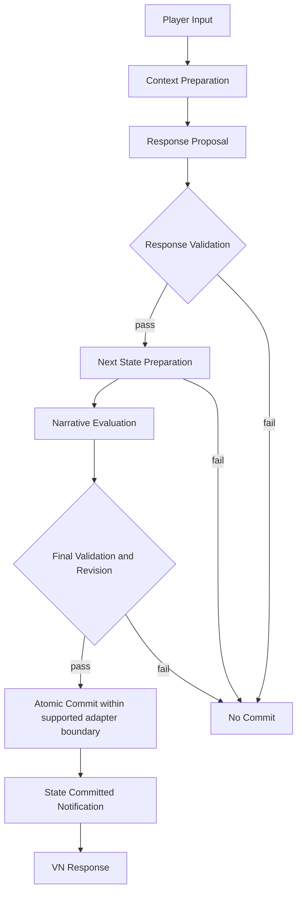

# Main Flow — Turn-Based Interaction

> 상태: **채택된 설계 흐름, Plugin 런타임 미구현**. [ADR-003](../../03_Decisions/03_ADR-003-Commit-Before-Response.md), [ADR-004](../../03_Decisions/04_ADR-004-Snapshot-State.md), [ADR-005](../../03_Decisions/05_ADR-005-Minimal-Game-Adapter.md)를 따른다.

| 단계 | 작업 | 불변조건 |
|---|---|---|
| Input | Text 또는 명시적 Silence, Turn ID·Character·Scene 식별 | Turn당 하나의 Interaction |
| Context | Character/Memory/World/Narrative 조회 및 Host Presentation Catalog에서 허용 ID/Variant 목록 획득 | 권위 State 변경 없음 |
| Proposal | Dialogue/Action/Expression/Event/Mutation 후보 생성 | LLM Proposal은 신뢰되지 않음 |
| Validation | Schema/Rules/Narrative Hard Constraint/Presentation ID 검증 | 실패 시 No Commit |
| Preparation | Current Snapshot 기반 WAIN + 지원되는 Game Prepared State 생성 | 권위 State 무변경 |
| Narrative Evaluation | 준비된 다음 상태로 Beat Completion·Transition 결정 | 초기 Turn당 최대 한 번 전이 |
| Final Validation | 전체 제약 및 Revision·Adapter 지원 범위 재확인 | 실패 시 Prepared 폐기 |
| Atomic Commit | 초기 Testbed에서 공유 Commit 경계로 새 WAIN/Game 상태 동시 확정 | 별도 순차 Apply로 원자성 주장 금지 |
| Notify / VN Response | Commit된 결과를 Game에 통지하고 VN 화면에 표시 | State 확정 후에만 정상 출력 |

## 현재 Testbed와의 차이

제공된 Testbed의 `WAINTestbedVNWidget.cpp`는 Trust/TurnCount 기반 Mock과 키워드 응답을 사용한다. 현재 Plugin Source/이 Transaction 구현은 없다. 따라서 Atomic Commit이 **이미 동작한다는 의미는 아니다**.

## 단계적 확장

초기에는 단일 세션·Game Thread·메모리 Snapshot 참여형 Game Adapter만 지원한다. 기존 Actor가 독립 권위 State를 가진 게임, 외부 DB 및 분산 Commit은 별도 설계·테스트 이후 지원한다.

[Commit Contract](../01_Contracts/05_Response-Validation-Commit.md) · [Narrative Contract](../01_Contracts/04_Narrative-Manager.md)

## Phase 1 실제 Mock 경로

현재 구현된 것은 `ProcessMockTurn → ValidateRequest → ProposalProvider.Generate → TransactionCoordinator.Execute → CommitResult → StateCommitted delegate → Result` 흐름이다. **Context Preparation / Presentation Query / 실제 LLM 생성 / 응답 표시**는 아직 없다. Sequence diagram의 전체 설계와 현재 구현을 구별한다.

사용되는 게임 State Adapter는 테스트 코드의 메모리 Map Snapshot이며, 실제 Testbed의 Actor/Widget/JSON을 변경하지 않았다. [Source Map](../02_Source/00_Source-Map.md).
