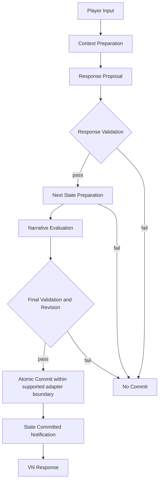

# Main Flow — Turn-Based Interaction

> 상태: **채택된 설계 흐름, Plugin 런타임 미구현**. [ADR-003](../../03_Decisions/03_ADR-003-Commit-Before-Response.md), [ADR-004](../../03_Decisions/04_ADR-004-Snapshot-State.md), [ADR-005](../../03_Decisions/05_ADR-005-Minimal-Game-Adapter.md)를 따른다.

| 단계 | 작업 | 불변조건 |
|---|---|---|
| Input | Text 또는 명시적 Silence, Turn ID·Character·Scene 식별 | Turn당 하나의 Interaction |
| Context | Character/Memory/World/Narrative 조회 및 Host Presentation Catalog에서 허용 ID/Variant 목록 획득 | 권위 State 변경 없음 |
| Proposal | Dialogue/Action/Expression/Event/Mutation 후보 생성 | LLM Proposal은 신뢰되지 않음 |
| Validation | Schema/Rules/Narrative Hard Constraint/Presentation ID 검증 | 실패 시 No Commit |
| Preparation | Current Snapshot 기반 WAIN + 지원되는 Game Prepared State 생성 | 권위 State 무변경 |
| Narrative Evaluation | 준비된 다음 상태로 Beat Completion·Transition 결정 | 초기 Turn당 최대 한 번 전이 |
| Final Validation | 전체 제약 및 Revision·Adapter 지원 범위 재확인 | 실패 시 Prepared 폐기 |
| Atomic Commit | 초기 Testbed에서 공유 Commit 경계로 새 WAIN/Game 상태 동시 확정 | 별도 순차 Apply로 원자성 주장 금지 |
| Notify / VN Response | Commit된 결과를 Game에 통지하고 VN 화면에 표시 | State 확정 후에만 정상 출력 |

## 현재 Testbed와의 차이

제공된 Testbed의 `WAINTestbedVNWidget.cpp`는 Trust/TurnCount 기반 Mock과 키워드 응답을 사용한다. 현재 Plugin Source/이 Transaction 구현은 없다. 따라서 Atomic Commit이 **이미 동작한다는 의미는 아니다**.

## 단계적 확장

초기에는 단일 세션·Game Thread·메모리 Snapshot 참여형 Game Adapter만 지원한다. 기존 Actor가 독립 권위 State를 가진 게임, 외부 DB 및 분산 Commit은 별도 설계·테스트 이후 지원한다.

[Commit Contract](../01_Contracts/05_Response-Validation-Commit.md) · [Narrative Contract](../01_Contracts/04_Narrative-Manager.md)

## Phase 1 실제 Mock 경로

현재 구현된 것은 `ProcessMockTurn → ValidateRequest → ProposalProvider.Generate → TransactionCoordinator.Execute → CommitResult → StateCommitted delegate → Result` 흐름이다. **Context Preparation / Presentation Query / 실제 LLM 생성 / 응답 표시**는 아직 없다. Sequence diagram의 전체 설계와 현재 구현을 구별한다.

사용되는 게임 State Adapter는 테스트 코드의 메모리 Map Snapshot이며, 실제 Testbed의 Actor/Widget/JSON을 변경하지 않았다. [Source Map](../02_Source/00_Source-Map.md).

## Phase 2 Character Context 구현 구간

`Context Preparation` 중 **Character 부분만** 구현되었다. 현재 `ProcessTurn`은 확정된 Root에서 Character State를 복사하고, 선택적으로 Host Persona Source를 조회·검증한 후 `GenerateWithContext`를 호출한다. 이전 절의 `Context Preparation 미구현` 표시는 Phase 1 당시 이력이다. 아직 Memory·World·Narrative Constraint·Presentation Catalog를 합친 완전한 Context는 아니며, 실제 LLM 호출 및 UI도 미지원이다.

[Context 구현 문서](../../04_Development/06_Character-Context-Implementation.md)

## Phase 2 Presentation 실제 구현 경로 (2026-11-11)

기존 흐름의 Character Context Builder가 Context Preparation 중 Host Catalog를 **한 번 조회·검증**하여 허용 ID/Variant/설명 목록을 Provider로 전달한다. Provider가 선택한 조합은 Transaction의 Response Validation 단계에서 동일한 목록과 대조하며, 성공한 경우에만 Prepared Snapshot과 Publish를 진행한다. Commit된 Expression/Variant는 `FWAINInteractionResult`에 포함된다. **실제 화면 표시·PNG 렌더링은 이번 Plugin 구현 범위가 아니다.**

[구현 상세](../../04_Development/07_Presentation-Catalog-Implementation.md)

## Phase 2 Observation Memory 추가 흐름 (2026-11-11)

`Context Preparation`은 **직전 확정 MemoryStream**에서 CharacterId별 Observation을 읽어 `RelevantMemories`에 담는다. `Transaction Preparation`은 Player 입력과 NPC 응답을 **PreparedWAIN.MemoryStream**에 추가한다. 모든 Snapshot 검증 및 Game Prepare 이후 Root Publish에 성공해야만 기록된다. 실패·Replay·타 캐릭터 Context에서는 Memory가 새로 추가/노출되지 않는다.

실제 Embedding 검색, Reflection, Plan, Save/Load, Prompt 직렬화는 아직 구현하지 않았다. [구현 상세](../../04_Development/08_Memory-Observation-Implementation.md).

## Phase 2 Narrative Context + Prepared Beat Evaluation (2026-11-11)

이번 코드에서 `Context Preparation`은 Character/Memory/Presentation 조회 후 `NarrativeEvaluator.BuildContext`로 **현재 활성 Beat 경로의 Goal·Soft Constraint**를 추가한다. Proposal을 만든 후 `NarrativeEvaluator.Evaluate`는 **Prepared WAIN + Prepared Game Snapshot**에서 구조화 Completion/Transition 조건, Chapter/Sequence/Beat Hard Rule을 평가한다. 전이 시 `BeatHistory`도 같은 Prepared Snapshot에 넣는다. Memory Planning은 새 Prepared Beat를 기준으로 재생성 여부를 판단한다. 이 기능은 실제 LLM Text Guard나 Scenario JSON Loader 구현을 의미하지 않는다. [구현 상세](../../04_Development/10_Narrative-Graph-Implementation.md).

## Phase 2 World Manager Integration (2026-11-12)

Current `Game Snapshot`을 공통 `IWAINWorldFactReader`로 읽는다. Context Preparation에서 Schema가 공개한 Fact만 Provider에게 제공하며, Proposal 생성 후 World State Manager가 Game Mutation 권한/범위를 검사한다. Game Adapter가 새로운 Prepared Snapshot을 반환하면 실제 값 전체를 다시 대조한 뒤 Narrative 평가와 기존 Publish 단계로 진행한다. **현재 Manager는 Game-owned int32 상태만 다루며, 실제 Host JSON 파싱과 Game Actor의 Apply는 포함하지 않는다.**

[World State 구현](../../04_Development/11_World-State-Manager-Implementation.md).

## 2026-11-12 실제 Host 전환 범위

실제 Testbed Widget의 Text/Silence 입력이 `UWAINRuntimeSubsystem::ProcessMockTurn`으로 전달된다. 초기 Context 정의는 Host JSON Loader가 준비하고 World Fact/Narrative/Expression 권한 검사를 통과한 Proposal만 WAIN Root에 Publish된다. 화면은 Commit된 Dialogue/Beat/Trust/Expression ID를 읽는다. **실제 LLM·PNG 렌더링까지 연결했다는 의미는 아니다.** [Host 구현](../../04_Development/12_Testbed-Content-Integration.md).
