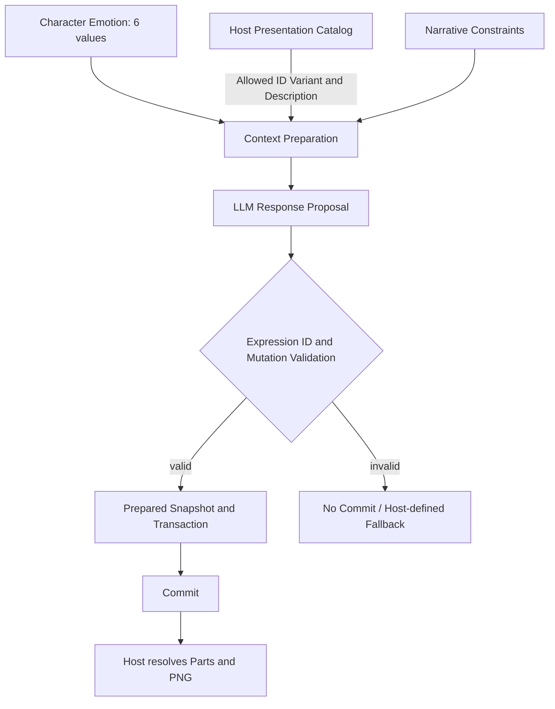

# Flow — Continuous Emotion to Visual Expression

> 내부 6차원 Emotion은 Character Agent 소유, Expression/PNG Catalog는 Host 소유. [ADR-002](../../03_Decisions/02_ADR-002-Emotion-Expression.md).

1. Emotion은 `joy/sadness/anger/disgust/anxiety/surprise`의 각 0~1 연속값이며 동시 존재 가능. Delta는 검증 후 Snapshot에만 반영한다.
2. **Context Preparation에서** Scene/Character/Pose에 맞는 허용 표현 ID·Variant·자연어 설명을 Host Catalog에서 조회한다.
3. 모델은 제공된 목록 중 `expression_id`/`variant_id`를 Proposal로 제안한다. 감정과 표정은 일대일 대응하지 않는다.
4. 없는 ID나 허용되지 않은 Variant는 검증에서 거절한다. 임의 Neutral 대체는 허용하지 않으며 Host가 명시한 정책만 사용할 수 있다.
5. Commit 성공 후 Host가 실제 Expression Preset/PNG 파츠를 해석하여 렌더링한다. Testbed 자산의 기존 PNG 이름은 변경하지 않는다.

**마이그레이션 참고:** 현 Testbed의 문자열 `Type/Intensity` JSON은 새 6차원 스키마와 아직 일치하지 않는다. 별도의 Content 변경 작업이 필요하다.

[Emotion/Expression Contract](../01_Contracts/07_Emotion-Expression-Boundary.md)
