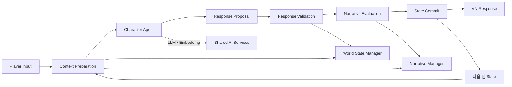

# WAIN System 아키텍처

> **핵심:** Orchestrator가 턴 순서를 조율하고 Character, World, Narrative 모듈은 각자 소유한 State와 책임을 유지한다. LLM 결과는 검증 전 Proposal이다.

상태: **기본 아키텍처 설계 기준** · 구현 확인: 미완료

## 목표와 범위

WAIN은 비주얼 노벨의 사전 정의 선택지 상호작용을 자유형 자연어 대화로 확장하면서 캐릭터의 지속 경험, World State와 Narrative Progress를 일관되게 유지하려는 재사용 가능한 Unreal Engine C++ Plugin이다.

초기 프로토타입은 **Single-Agent, Turn-Based Interaction**에 한정한다. 상태 변경은 대화 상호작용에서 발생한 것으로 제한하며 독립 실시간 World Event, NPC 자율 행동, Multi-Agent 동시 실행은 범위에서 제외한다. 비동기 LLM 호출은 허용하지만 동시에 여러 턴이 State를 바꾸는 구조를 목표로 하지는 않는다.

## 핵심 모듈과 책임

| 모듈 | 책임 | 소유하지 않는 것 |
|---|---|---|
| Interaction Orchestrator | 한 Interaction의 입력부터 Commit·VN 출력까지 순서와 호출 조율 | Character·World·Narrative State의 직접 소유 |
| Character Agent | Persona, Relationship, Emotion, Memory, Plan을 바탕으로 Context와 응답 Proposal 구성 | World State 및 Narrative Progress의 최종 결정 |
| World State Manager | WAIN 내부 World State, Schema, 외부 Game State 접근, 승인 변경 적용 | 게임이 소유하는 State의 중복 복제 |
| Narrative Manager | Narrative Definition, Active Beat, Goal·Constraint, Completion·Transition 판단 | LLM 출력만으로 진행 확정 |
| Response Validator | Proposal Schema, 게임 규칙, 서사 제약 검증 | 검증 실패 결과의 Commit |
| Shared AI Services | 비동기 LLM 및 Embedding Provider 추상화, 오류·사용량·지연 관측 | 기능별 Prompt 및 결과 의미 해석 |

## 턴 데이터 흐름

## State 소유권

Persona, Relationship, Emotion, Character Memory는 Character Agent 영역이다. WAIN이 직접 관리하기로 한 World Facts는 Internal State Store가 소유한다. Inventory·Quest·Actor 상태 등 게임 고유 상태는 원래 게임 시스템이 소유하며 Adapter를 통해 접근한다. Active Beat, Completed Beat, Beat History는 Narrative Manager가 관리한다. Orchestrator는 요청을 조율할 뿐 각 Source of Truth를 대체하지 않는다.

## 설계 기준과 구현 상태

이 페이지와 Contracts는 `설계.md` 및 2026-10-28 중간발표 PDF·대본의 설계 기준을 정리한다. 플러그인 경로에서 README와 문서/자료만 확인했고 `.uplugin` 및 런타임 C++ 소스는 확인하지 못했다. 미결 사항은 [[../03_Development/01_Current-Work|Current Work]]를 본다.
