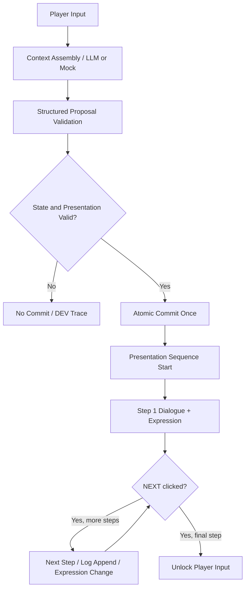

# WAIN — Relationship Semantics & Presentation Steps

> 구현 기준: `WAINTestbed-Source(3).zip` 및 Narrative v2 적용본. UE 5.8 `WAINTestbedEditor Win64 Development` 빌드는 2026-11-15 성공했다. Automation/PIE/OpenAI 실호출은 실행하지 않았다.

## 00. 계약 변경 (Breaking Change)

- **이전 단일 `Dialogue / ExpressionId / ExpressionVariantId` 필드는 제거했다.** 호환 파서·fallback·자동 변환은 없다.
- `FWAINResponseProposal`과 `FWAINInteractionResult`는 `TArray<FWAINPresentationStep> PresentationSteps`만 사용한다.
- JSON의 최상위 필수 필드는 **`presentationSteps`, `actionId`, `mutations`**이다. Step의 필수 필드는 **`dialogue`, `expressionId`, `expressionVariantId`**이다.
- Step 개수는 **1~5**, 개별 대사 최대 **800자**, 예외 발생 시 **No Commit**.
- `Narrative Beat`는 서사 단위이며 `Presentation Step`은 같은 Interaction Turn 내의 화면 표시 단위다.
- 한 턴의 상태 변경과 Memory Observation은 단일 Transaction에서만 처리하고, UI의 Step 이동은 Runtime을 호출하지 않는다.
- 기존 Mock, 테스트, 진단 출력도 모두 새 계약으로 바꿨다. 구형 JSON을 그대로 반환하면 거절한다.

## 10. 관계 상태와 정의

| 필드 | Mutation Target | 의미 |
|---|---|---|
| Trust | `relationship.trust` | 상대방의 의도와 약속을 신뢰하는 정도 |
| Affection | `relationship.affection` | 긍정적 정서적 호감 (연애 감정과 분리) |
| Familiarity | `relationship.familiarity` | 상대방에 대한 경험 및 익숙함 |
| Comfort | `relationship.comfort` | 상대 앞에서 평소 느끼는 편안함 (순간 감정과 구분) |
| RomanticAttraction | `relationship.romantic_attraction` | 상대를 연애 대상으로 의식하는 정도 |

- 범위는 모두 **0~100**의 `int32`, `AddInteger/SetInteger`만 허용한다. 6차원 Emotion의 `AddFloat`는 기존과 같다.
- 이번 버전은 **단일 Character → Player 관계**를 유지한다. 방향 그래프와 Multi-Agent 관계 저장 구조는 구현하지 않는다.
- 공통 의미는 `Content/Data/RelationshipDefinitions.json`의 **`semantic_anchors.low/neutral/high`**에 둔다. `20/50/80`은 Threshold가 아닌 대표 기준점이다.
- 캐릭터별 표현은 `Content/Data/Characters/ManaPersona.json`의 **`relationship_responses`**에 둔다. 각각 `attitude`, `emotional_response`, `dialogue_style`을 제공한다.
- 시작 수치는 `Content/Data/Scenarios/CH01RelationshipState.json`에 둔다. 공통 관계 정의에 캐릭터별 시작값을 넣지 않는다.
- Context는 현재 수치와 *가장 가까운 의미 기준점*의 공통 설명·마나 반응을 Prompt로 전달한다. 관계 수치만으로 표정이 결정되지는 않는다.

## 20. Global Dialogue Rules

- 공통 규칙은 `Content/Data/DialogueRules.json`, 캐릭터 성격과 말투는 Persona에 보관한다.
- `WAINPromptBuilder::BuildSystemInstruction`은 공통 금지 표현을 전달한다. `WAINDialogueValidator`는 모든 Step에서 텍스트 금지 표현과 이모지를 검사한다.
- 실제 Commit 경로도 같은 규칙을 검사하므로 Structured Output에서 통과했더라도 재검증된다.
- 성격 일관성 및 감정과 표정의 적합성을 정규식만으로 보장하지 않는다. 이는 대화 시나리오 평가가 필요하다.

## 30. VN 재생 상태 기계



- UI의 `다음 ▶` 버튼은 다음 Step을 표시한다. 마지막 Step을 넘긴 후 입력창이 해제된다.
- Step마다 대사·표정 쌍을 검증하고, 그 Step이 표시될 때만 LOG에 추가한다.
- Memory에는 캐릭터의 여러 Step 대사가 줄바꿈으로 합쳐진 하나의 Observation으로 저장된다.
- DEV Trace에는 미확정 Proposal의 Step 목록, State 탭에는 5개 관계 수치의 변경 전후를 표시한다.

## 40. 파일 배치 및 적용

```text
Plugins/WAINSystem/Source/WAINSystem/
  Public/WAINRuntimeTypes.h                 # 5 관계값 + FWAINPresentationStep
  Public/WAINRelationshipTypes.h            # Semantic Anchor / Reaction / Dialogue Rule
  Public/WAINCharacterContext.h             # 조회 가능한 정적 정의
  Private/Character/                      # 5개 관계값 Prepared Mutation
  Private/LLM/Prompt/                     # 상세 Persona + 관계 의미
  Private/LLM/Validation/                 # Strict Steps + Dialogue Validator
  Private/Core/                           # No Commit / Single Commit
Source/WAINTestbed/
  Data/                                    # 3개 JSON 로더 + Persona
  Presentation/                            # Sequence Player
  UI/                                      # NEXT + LOG + DEV
Content/Data/
  DialogueRules.json
  RelationshipDefinitions.json
  Characters/ManaPersona.json
  Scenarios/CH01RelationshipState.json
```

**적용:** 이번 압축은 이전 Content 이미지/Png를 포함하지 않는다. 기존 로컬 `Content/Images`는 유지하고, `Content/Data` JSON을 프로젝트에 병합한다. C++ 소스는 전체 교체를 권장한다. 이전 단일 응답 계약으로 빌드한 DLL/캐시를 재사용하지 않는다.

## 50. 검증

- JSON 형식·관계 파라미터 정합성·새 Structured Schema 정적 검사.
- 테스트 코드: 파라미터 Add/Set과 범위 오류, 금지 표현, Prompt 기준점, 2 Step 파싱/재생 및 단일 Commit.
- **검증 완료:** UE 5.8 `WAINTestbedEditor Win64 Development` 컴파일·링크 성공.
- **미실행:** UE Automation 실행, PIE UI/표정 이미지, 실제 GPT API 결과.
